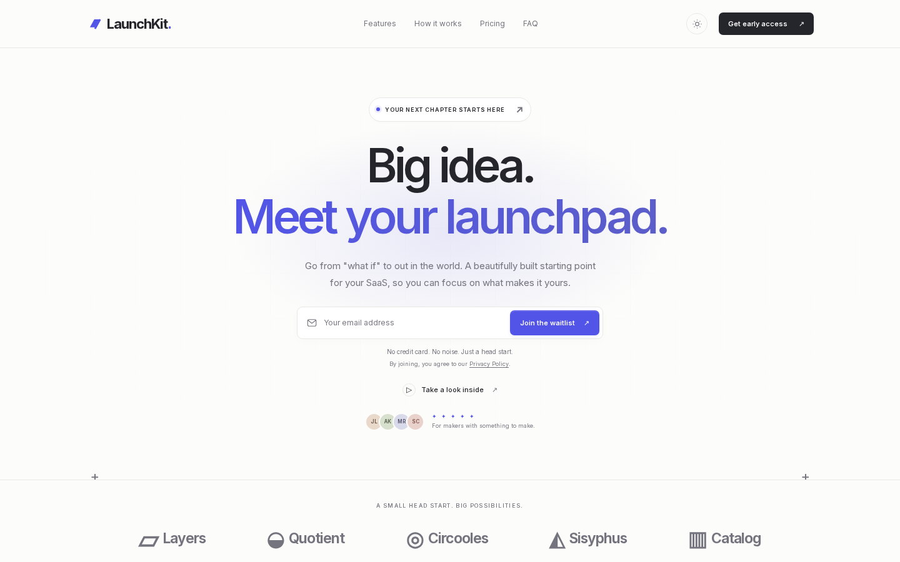
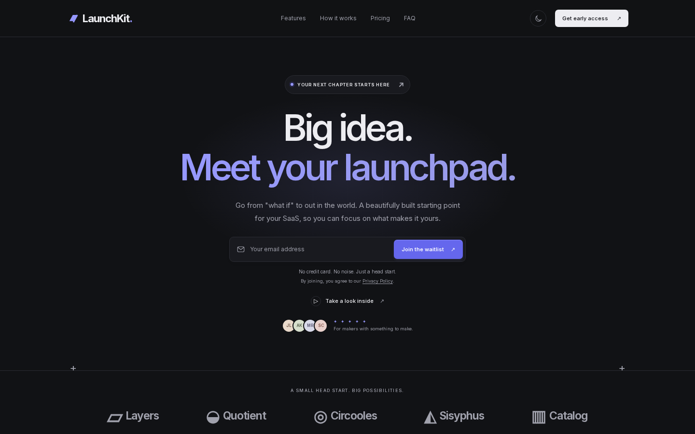
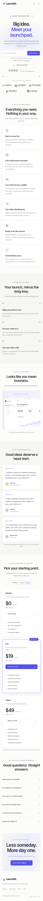

# LaunchKit

A Next.js SaaS landing page and waitlist template by Kenson Dev. Free and open source (MIT). Fork it, adapt it to your product, and deploy it to a host that supports Next.js server routes. No paid dependency, API key, or external image service is needed to run the default demo.



<details><summary>More screenshots</summary>




</details>

## Quickstart

```bash
git clone https://github.com/kensondev/nextjs-launchkit.git
cd nextjs-launchkit
npm install
cp .env.example .env.local   # optional; console mode needs no keys
npm run dev                  # http://localhost:3000
npm run build                # production build
```

LaunchKit is a website template, not a SaaS application backend. It does not include authentication, billing, a database, a working analytics dashboard, or checkout.

## What's included

- Responsive landing page with mobile navigation, hero, brand strip, feature grid, how-it-works section, HTML/CSS product preview, testimonials, pricing toggle, FAQ, and final call to action.
- Light and dark themes with a saved browser preference.
- A waitlist form and server endpoint, email validation, a honeypot, and a basic per-IP rate limit.
- Console, webhook, and Resend audience delivery modes, configured with server-side environment variables.
- A waitlist confirmation page, custom 404, and editable privacy and terms pages.
- Search and social metadata, generated social preview, sitemap, and robots directives.
- Central TypeScript configuration for public copy, colors, links, pricing, and optional sections.
- Next.js 16.4.3 App Router, React 19.3, TypeScript, and Tailwind CSS 4.

## Quickstart

Use Node.js 20.9 or newer, preferably a currently supported LTS release, and npm.

```bash
npm ci
cp .env.example .env.local
npm run dev
```

Open [http://localhost:3000](http://localhost:3000). Submit your own email in the form and look for a structured `waitlist.signup` entry in the server terminal. Console mode does not send mail or save a subscriber database. Do not mistake the confirmation page for proof of durable storage.

Available commands:

```bash
npm run dev    # Development server
npm run lint   # ESLint
npm run build  # Production build, including TypeScript checking
npm run start  # Serve an existing production build
```

There is no automated test script bundled with this template. Before publishing, run lint and build, then test the form and your chosen provider on your deployment.

## Make it yours

### Copy, links, and pricing

Edit `src/config/site.ts`. This file supplies the brand name, description, navigation, email address, button labels, waitlist messages, section copy, pricing plans, testimonials, and legal-page text.

- Replace `name`, `productName`, `description`, and the placeholder contact `email`.
- Set `NEXT_PUBLIC_SITE_URL` to the canonical origin, such as `https://yourproduct.com`. This public value feeds site metadata and discovery routes. Restart development after changing environment variables and redeploy after changing production values.
- Update the `links` and `navigation` entries when changing routes or destinations. Pricing buttons lead to the waitlist by default; there is no payment processor behind them.
- Edit `pricing.tiers`. `monthly` is the monthly amount, and `yearly` is the per-month amount shown for annual billing, not an annual total. Update savings and billing labels to match your offer.
- Replace the example privacy and terms text with policies reviewed for your business before collecting real addresses.

Keep secrets out of this config and out of variables prefixed with `NEXT_PUBLIC_`. Next.js can ship public variables to the browser.

### Colors

Change `site.colors` in `src/config/site.ts`:

| Key | Purpose |
| --- | --- |
| `brand` | Main light-theme accent |
| `brandHover` | Hover accent |
| `brandSoft` | Subtle light-theme accent background |
| `darkBrand` | Accent in dark mode |
| `darkSoft` | Subtle dark-theme accent background |

The layout turns `site.colors` and `site.palettes.light` / `site.palettes.dark` into CSS variables. The palettes control backgrounds, text, borders, and success colors; `colors` also includes avatar and preview accents. Layout and spacing live in `src/app/globals.css`. Check contrast in both themes after changing the palette.

### Font

The default font is Inter, loaded through `next/font/google` in `src/app/layout.tsx` and exposed as `--font-inter`. To change it, replace the font import and loader, then update the font variable used by `src/app/globals.css`. Google font downloads need network access during a fresh build. For an offline build or a private font, use `next/font/local` with font files you are licensed to distribute.

### Section toggles

Set any of these `site.sections` values to `false` to hide that section:

```ts
sections: {
  logos: true,
  features: true,
  howItWorks: true,
  preview: true,
  testimonials: true,
  pricing: true,
  faq: true,
  finalCta: true,
}
```

Remove matching navigation links when hiding a linked section. The hero and its waitlist form remain the primary signup path.

## Waitlist setup

Copy `.env.example` to `.env.local` for development. Set these same values in your hosting provider's environment settings for production. Do not commit `.env.local`.

| Variable | When required | Meaning |
| --- | --- | --- |
| `NEXT_PUBLIC_SITE_URL` | Production | Canonical public site origin |
| `WAITLIST_PROVIDER` | Optional | `console`, `webhook`, or `resend`; defaults to `console` |
| `WAITLIST_WEBHOOK_URL` | Webhook mode | Destination for the server's POST request |
| `RESEND_API_KEY` | Resend mode | Private API key with permission to create audience contacts |
| `RESEND_AUDIENCE_ID` | Resend mode | ID of the audience that receives contacts |

### Console mode

```dotenv
WAITLIST_PROVIDER=console
```

A successful signup writes a JSON log entry with `event`, `provider`, `email`, and `timestamp`. This is useful for local development, not a production mailing list. Logs may expire, disappear on restart, or be unavailable to you, depending on the host. Log access also exposes submitted email addresses. Configure retention and permissions before using real data.

### Webhook mode

```dotenv
WAITLIST_PROVIDER=webhook
WAITLIST_WEBHOOK_URL=https://your-service.example/waitlist
```

The server sends `POST` with `Content-Type: application/json` and this body:

```json
{ "email": "person@example.com" }
```

The destination must return a 2xx status only after it accepts the address. The template does not read or expose the response body. Use HTTPS in production. HTTP is accepted for local development. Redirects are rejected, and delivery times out after eight seconds. The adapter does not add an authorization header or signature. Add your own server-side authentication if your receiving service requires it, and treat a secret webhook URL as a credential.

### Resend mode

Create an audience in your Resend account and use its ID with an API key allowed to manage contacts:

```dotenv
WAITLIST_PROVIDER=resend
RESEND_API_KEY=re_your_private_key
RESEND_AUDIENCE_ID=your_audience_id
```

The server calls `POST https://api.resend.com/audiences/{audienceId}/contacts` with bearer authentication and `{ "email": "person@example.com", "unsubscribed": false }`. This adds a contact to the audience. It does not send a welcome email, create a campaign, or implement double opt-in. Configure consent, unsubscribe handling, and email delivery for your business and applicable law. Resend plan limits and charges are separate from the template license.

### Endpoint contract

`POST /api/waitlist` accepts a JSON object with a string `email` and an optional string `website`. The form leaves `website` empty; it is a hidden honeypot, not a website URL input. A nonempty honeypot returns the normal success response without contacting a provider or logging a signup.

```bash
curl -i http://localhost:3000/api/waitlist \
  -H 'Content-Type: application/json' \
  -d '{"email":"you@example.com","website":""}'
```

| Status | Meaning |
| --- | --- |
| `200` | Provider accepted the request, console logged it, or the honeypot caught it |
| `400` | Malformed JSON, a body over 8 KiB, or invalid input |
| `429` | Rate limit reached, with a `Retry-After` header in seconds |
| `502` | Provider failed, timed out, or returned a non-2xx response |
| `503` | Provider name is unsupported or required configuration is missing or invalid |

Success responses are `{ "success": true, "message": "..." }`. Errors are `{ "success": false, "error": "..." }`. All user-facing messages come from `site.waitlist`. Errors never echo an email address, secret, webhook URL, or provider response. Server failure logs include only an event, provider name, and an HTTP status when available.

Email validation checks a practical ASCII email format, not mailbox ownership or deliverability. The endpoint does not deduplicate signups, retry failed deliveries, queue work, or guarantee exactly-once delivery. A provider can accept a request before a network timeout, so a retry can create duplicates. Use provider-side deduplication and add a durable queue if your product needs stronger guarantees.

### Spam protection and proxy trust

The limiter allows five requests per IP in a fixed 60-second window. Invalid and honeypot requests count too. It removes expired entries on incoming requests and stores at most 10,000 active IP entries in memory. At capacity, previously unseen IPs receive `429` until space expires.

The handler uses the first address in `x-forwarded-for` if it is a valid IP, then `x-real-ip`, and otherwise puts callers in a shared `unknown` bucket. Run it only behind a trusted proxy that overwrites untrusted incoming forwarding headers. If a caller can supply these headers directly, they can bypass the per-IP limit. Check your host's actual forwarding behavior; do not assume every proxy uses the same chain order. Visitors behind the same network may share a limit.

This is a small, best-effort abuse guard, not bot prevention. Its state resets on restart, redeploy, and serverless cold starts. Each instance has a separate map, so the effective limit increases with the instance count. For a public high-traffic launch, use your host's edge rate limiting or replace this map with a shared durable limiter. The honeypot does not stop a bot that knows the form shape.

### Verification scope

Integration testing is local only. Live Resend delivery, your webhook service, account permissions, consent settings, and production hosting behavior are not certified by the template. Before launch, send a real signup through your deployed form, verify it arrived in the destination, then exercise missing configuration, upstream failure, validation, and rate-limit responses. Check that no private keys appear in browser requests or generated client assets.

## Deploy

Use a Next.js server deployment, not a static export. The waitlist endpoint needs a Node.js runtime. Keep provider secrets in the host's server-side environment settings.

### Vercel

1. Push your customized project to a private Git repository.
2. Import it in Vercel and use the Next.js preset. Keep the project root at the directory containing `package.json`.
3. Set `NEXT_PUBLIC_SITE_URL` to your production origin and add your chosen waitlist provider variables. Configure preview deployments separately so test addresses do not enter your production audience by accident.
4. Deploy with the standard `npm run build` command. Attach your domain, then redeploy if the canonical origin changed.
5. Test the deployed form, confirmation page, metadata, and provider destination. Inspect server logs without sharing subscriber addresses publicly.

### Netlify

1. Push the project to a private Git repository and import it into Netlify.
2. Use Netlify's current Next.js integration and a Node.js version supported by both this Next.js version and Netlify. Let the integration manage Next.js output and server functions. Do not configure an `out` directory or a plain static-site deployment.
3. Set the build command to `npm run build`. Add `NEXT_PUBLIC_SITE_URL` and the private provider variables in Netlify's environment settings, with the appropriate deploy contexts.
4. Deploy, attach your domain, and repeat the deployed form and destination checks described above.

Both platforms can change runtime support and configuration. Confirm that your selected plan supports Next.js 16 and server route handlers. A successful build alone does not verify provider delivery. Other hosts work if they support this Next.js version and the Node runtime; for a self-hosted production server, run `npm run build` followed by `npm run start` behind a trusted HTTPS proxy.

## File structure

```text
src/
  config/site.ts                 Public brand, copy, links, sections, and pricing
  app/
    page.tsx                     Landing page composition
    layout.tsx                   Root layout, Inter font, and metadata
    globals.css                  Tailwind import and site styles
    api/waitlist/route.ts         Validation, rate limiting, and provider delivery
    waitlist/thanks/              Confirmation route
    privacy/                     Editable privacy page
    terms/                       Editable terms page
    not-found.tsx                Custom 404
    sitemap.ts                   Sitemap
    robots.ts                    Robots directives
    opengraph-image.tsx           Generated social image
  components/
    controls.tsx                 Interactive site controls and form
    dashboard.tsx                Illustrative product preview
public/                          Static assets
.env.example                     Environment variable reference
LICENSE                          MIT License
CHANGELOG.md                     Release history
```

## Demo disclosure and launch checklist

The logos are illustrative brand labels, not endorsements. Avatar initials, testimonials, names, dashboard metrics, activity, and pricing plans are sample content. Testimonials are not verified customer statements. The product preview is HTML/CSS, not a functioning app. The monthly/yearly toggle changes displayed example prices only, and no checkout is connected.

Before launch:

- Replace or remove every demo testimonial and logo, plus the product preview and sample pricing if they do not describe your product.
- Set real brand details, navigation links, contact address, canonical origin, and social metadata.
- Review keyboard navigation, mobile layouts, reduced-motion behavior, and color contrast after customization.
- Choose a durable waitlist destination and test it through the production form.
- Review proxy trust and production abuse protection.
- Replace the example privacy and terms pages. Disclose your providers, data retention, consent basis, and deletion contact.
- Run lint and a production build. Test both themes, signup errors, success navigation, legal links, and the custom 404.

## FAQ

### Can I use it for a client?

Yes. It is MIT-licensed: use it for any number of personal, commercial or client projects. Keep the license notice in copies of the source.

### Why did the form succeed but no email arrived?

Console mode only logs. Webhook mode only sends to your configured URL. Resend mode adds an audience contact and does not send an email. Check which provider is configured on the server and verify its destination. The honeypot also returns success without delivery.

### Why do all local requests share a rate limit?

When no valid forwarded IP is available, the endpoint uses a shared `unknown` key. Wait for the 60-second window to expire. On a real host, verify that your trusted proxy supplies and sanitizes the forwarding headers before changing limiter behavior.

### Can I host it as static HTML?

Not with the included server endpoint. Deploy with Next.js server support, or implement and connect an external waitlist endpoint yourself before using a static export.

### Does the license cover third-party software and fonts?

No. Next.js, React, Tailwind CSS, Inter, and other third-party packages retain their own licenses. Review those licenses and any assets you add. The MIT license covers the original template source.

### How do I get support?

Open an issue on this GitHub repository. Include the template version, Node.js version, deployment host, reproduction steps, and sanitized logs. Never send API keys or subscriber lists. The `hello@example.com` address in the demo is placeholder content, not a support inbox. Support is best-effort; no response time or update schedule is promised.

## Built with AI assistance

This project was written with the help of AI coding assistants and then reviewed and tested by the maintainer. Please review the code before using it in production, and open an issue if you find a problem.

## Support this project

This project is free and MIT-licensed. If it saved you time, an optional tip is appreciated and helps keep it maintained.

- **Solana (SOL or USDC on Solana):** `Cx9qsVknF5FYB2sS925zssK6GeiHBSy5gzwss8MxS3wp`
- Pay link (SOL): [`solana:Cx9qsVknF5FYB2sS925zssK6GeiHBSy5gzwss8MxS3wp?label=kensondev&message=Thanks`](solana:Cx9qsVknF5FYB2sS925zssK6GeiHBSy5gzwss8MxS3wp?label=kensondev&message=Thanks)
- Pay link (USDC): [`solana:Cx9qsVknF5FYB2sS925zssK6GeiHBSy5gzwss8MxS3wp?spl-token=EPjFWdd5AufqSSqeM2qN1xyybapC8G4wEGGkZwyTDt1v&label=kensondev`](solana:Cx9qsVknF5FYB2sS925zssK6GeiHBSy5gzwss8MxS3wp?spl-token=EPjFWdd5AufqSSqeM2qN1xyybapC8G4wEGGkZwyTDt1v&label=kensondev)

Please only send SOL or Solana-network USDC to this address. Tips are voluntary and do not buy support, priority or any license rights.

## License

[MIT](./LICENSE) © 2026 Kenson (kensondev)
